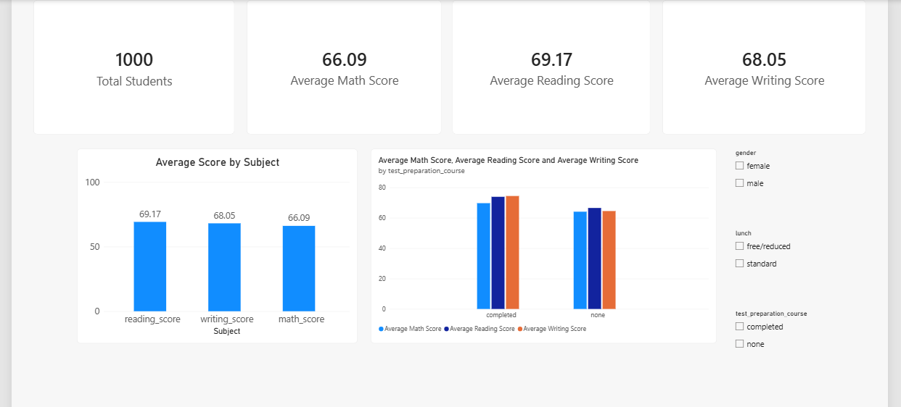
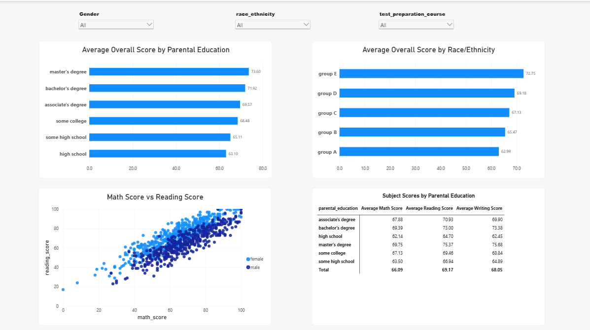

# Student Performance Analytics

## Project Overview

This project analyses student examination performance to identify subject-level trends and explore how scores vary across test preparation, parental education, gender, lunch category, and race/ethnicity groups.

The objective is to turn raw student examination data into meaningful findings using Python, SQL and Power BI.

## Business Objectives

- Compare average Math, Reading and Writing scores.
- Examine score differences associated with test preparation.
- Explore academic performance across student groups.
- Investigate relationships between subject scores.
- Build an interactive Power BI dashboard to support data exploration.

## Tools and Technologies

- **Python:** Pandas, NumPy, Matplotlib and Seaborn
- **Database:** MySQL
- **Data visualisation:** Microsoft Power BI
- **Query language:** SQL
- **Version control:** Git and GitHub

## Project Workflow

1. Inspect and validate the dataset.
2. Perform exploratory data analysis using Pandas and NumPy.
3. Calculate descriptive statistics and compare student groups.
4. Use MySQL to answer analytical questions.
5. Create DAX measures and interactive Power BI reports.
6. Validate the report results and document the findings.

## Key Findings

- The dataset contains 1,000 student records.
- Average Math score: 66.09.
- Average Reading score: 69.17.
- Average Writing score: 68.05.
- Students who completed test preparation had higher average scores in all three subjects than students who did not.
- The largest observed test-preparation score difference was in Writing.

These findings are descriptive. The analysis does not establish that test preparation or any demographic characteristic directly causes differences in scores.

## Power BI Dashboard

### Page 1 — Performance Overview

Summarises student counts, average subject scores and comparisons associated with test preparation.

### Page 2 — Student Group Analysis

Explores differences across student groups, compares subject performance and visualises the relationship between Math and Reading scores.

## Data Quality

The initial data checks found no missing cells, no exact duplicate rows, and scores within the expected 0–100 range.

## Limitations

- The analysis is based on an observational dataset.
- Group sizes differ.
- The dataset contains limited information about factors affecting student performance.
- Group averages and correlations should not be interpreted as causal relationships.

## Repository Structure

- `data/` — source dataset, subject to its licence
- `notebooks/` — Python analysis
- `sql/` — SQL scripts
- `powerbi/` — Power BI report and screenshots
- `docs/` — data dictionary and business insights

## Conclusion

This project demonstrates an end-to-end **data analytics workflow** using Python, MySQL and Power BI, from exploratory analysis through SQL-based investigation and interactive reporting.
